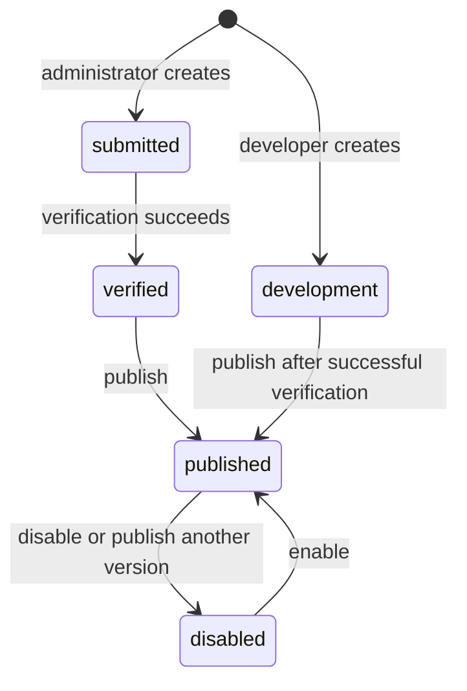

# Marketplace Backend

## Overview

The marketplace allows third-party vendors to list apps (widget + prompt bundles) that users can subscribe to. Each app points to a backend that serves `widgets.json` and `apps.json` manifests.

### Models

- Vendor: a company/team that provides apps (has optional `owner_uuid` for developer ownership)
- VendorApp: an app listing with manifest URLs, verification state, cached data, `owner_uuid`, and `version`
- UserAppSubscription: tracks which users have subscribed to which apps

### App Lifecycle



Administrators can remove an app in any state. Removed apps are hidden permanently.

| Status | Description |
|---|---|
| submitted | Administrator submission awaiting successful verification |
| verified | Automatic verification passed (manifests reachable and valid) |
| development | Visible to the app owner for testing before publication |
| published | Visible to all users in `GET /marketplace/apps` |
| disabled | Temporarily hidden from public catalog |
| removed | Permanently hidden |

### Versioning

Each app has a `version` field (free-form string like `"1.0"`, `"1.1"`, `"2.0"`). The unique constraint `(vendor_uuid, name, version)` permits multiple versions of the same app name.

- Only one version of a given app can be `published` at a time
- Publishing a new version auto-disables the previously published version
- To roll back: publish the older version again
- Versions don't count against the developer app limit (limit counts by distinct app name)

### Authentication

- `/admin/marketplace/*` endpoints require a superuser session token
- `/marketplace/developer/*` endpoints require a regular user session token (developer self-serve)
- Public endpoints work without auth, but authenticated users also see their own `development` apps

---

## App submission and administration

Use the [developer guide](developer-marketplace.md) to create, preview, version, and update an app. Use the [administrator guide](admin-marketplace.md) for verification, publication, rollback, removal, and subscription statistics.

## Public Endpoints

No auth required (but authenticated users also see their own `development` apps).

```bash
# List all published apps (+ own development apps if authenticated)
curl http://localhost:8080/api/marketplace/apps

# Get a single published app (or own development app if authenticated)
curl http://localhost:8080/api/marketplace/apps/<APP_ID>
```

The response includes `isDevelopment: true` for apps in development status.

The `widgets` array lists widgets referenced by tab layouts. Each entry includes its number of layout placements:

```json
{
  "widgets": [
    {
      "id": "stock_price_chart",
      "name": "Stock Price Chart",
      "description": "Real-time stock price chart",
      "count": 2
    },
    {
      "id": "market_overview",
      "name": "Market Overview",
      "description": "Daily market summary",
      "count": 1
    }
  ],
  "total_widgets": 3
}
```

`total_widgets` counts layout placements, including repeated widgets.

---

## User Subscription Endpoints

Require a regular user session token. Users can subscribe to published apps and their own development apps.

```bash
# Subscribe to an app
curl -X POST http://localhost:8080/api/marketplace/apps/<APP_ID>/subscribe \
  -H "Authorization: Bearer <TOKEN>"

# Unsubscribe (soft-delete, returns 204)
curl -X DELETE http://localhost:8080/api/marketplace/apps/<APP_ID>/subscribe \
  -H "Authorization: Bearer <TOKEN>"

# List active subscriptions
curl http://localhost:8080/api/marketplace/subscriptions \
  -H "Authorization: Bearer <TOKEN>"
```

Administrator subscription statistics are documented in the [administrator guide](admin-marketplace.md#subscription-stats).

## Vendor App Manifest Requirements

The vendor's backend must serve two JSON files at `{backend_base_url}/widgets.json` and `{backend_base_url}/apps.json`.

The [widget specification](../workspace_mcp/app_builder/resources/specs/widgets-json.md) defines widget declarations, and the [app specification](../workspace_mcp/app_builder/resources/specs/apps-json.md) defines tabs, layouts, and prompts. Both manifest URLs must be reachable by HEAD and return valid JSON by GET for marketplace verification to pass.

### MCP servers (`mcp_servers`)

An app entry in `apps.json` can also declare MCP servers. When present, the app's marketplace page in OpenBB Workspace shows a "Connect" action for the server:

```json
[
  {
    "name": "My App",
    "mcp_servers": [
      {
        "name": "Acme Research MCP",
        "description": "Query Acme research data via MCP tools.",
        "url": "https://mcp.acmedata.com/mcp",
        "authType": "token"
      }
    ]
  }
]
```

| Field | Details |
|---|---|
| `name` | Display name for the MCP server |
| `description` | Optional short description of what the server provides |
| `url` | The MCP server endpoint URL |
| `authType` | Optional. `"oauth"` (default) or `"token"`. With `"oauth"`, Workspace runs the standard MCP OAuth flow when the server returns a 401. With `"token"`, Workspace prompts the user for a static access token and sends it as an `Authorization: Bearer <token>` header on every request to that server; a 401 is treated as an invalid/expired token and never falls back to OAuth. |

Declare `mcp_servers` in the first app entry in `apps.json`.

---

For a local backend environment, follow [backend development setup](../DEVELOPMENT_SETUP.md).
